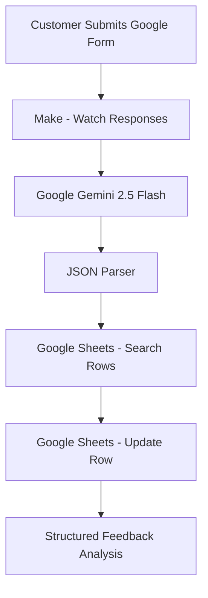

# Automated Feedback Analysis Workflow with Google Forms, Google Gemini AI

## Project Overview

An AI-powered feedback analysis solution designed to automate
the collection, classification, summarization, and reporting
of customer feedback.

This project integrates Google Forms, Make.com, Google Gemini AI,
and Google Sheets to transform unstructured customer feedback
into structured, actionable business insights.

The objective is to reduce manual feedback processing and help
businesses better understand customer satisfaction and identify
opportunities for continuous improvement.

## Business Problem

Businesses receive customer feedback through surveys, reviews,
and other communication channels.

Manually reviewing and categorizing this information can be
time-consuming, inconsistent, and difficult to scale.

These challenges include:

- Time-consuming manual feedback analysis
- Inconsistent sentiment classification
- Delayed identification of customer concerns
- Unstructured customer feedback
- Limited visibility into customer satisfaction
- Increased administrative workload

## The Solution

This project automates the customer feedback analysis process
using generative AI and workflow automation.

Customer responses collected through Google Forms are sent to
Google Gemini AI, which evaluates customer satisfaction,
classifies sentiment, and generates a concise summary.

The AI-generated response is converted into structured JSON
fields and automatically mapped to the corresponding customer
feedback record in Google Sheets.

## Technology Stack

| Technology | Purpose |
|---|---|
| Make.com | Workflow automation and orchestration |
| Google Forms | Customer feedback collection |
| Google Gemini 2.5 Flash | Sentiment analysis and summarization |
| JSON Parser | Structured AI output processing |
| Google Sheets | Feedback storage and reporting |
| JSON | Data transformation and workflow configuration |

## Workflow Architecture



## How It Works

### 1. Customer Feedback Collection - Google Forms

Customers submit feedback through a Google Form containing
two questions:

**Question 1:**

How satisfied are you with our product or service?

Available responses:

- Very satisfied
- Satisfied
- Neutral
- Unsatisfied
- Very unsatisfied

**Question 2:**

Please describe your experience or share any feedback
in your own words.

This combination allows the workflow to analyze both
structured satisfaction responses and unstructured
customer comments.

### 2. Automated Trigger - Make.com

The Google Forms Watch Responses module monitors
new customer feedback submissions.

The module is configured to retrieve up to 15
responses per execution.

The project demonstrates a scheduled polling workflow
with a 15-minute interval configured in Make.

### 3. AI Feedback Analysis - Google Gemini

Gemini 2.5 Flash receives both customer responses and
performs two primary functions:

**Sentiment Classification**

- Positive
- Neutral
- Negative

**Feedback Summarization**

Generates a concise one-to-two-sentence summary that
reflects both the satisfaction rating and written feedback.

The AI is instructed to return only a valid JSON object,
allowing downstream modules to process the results.

### 4. Prompt Engineering and Structured AI Output

The workflow uses a controlled AI prompt to standardize
the response format.

Prompt requirements include:

- Return only valid JSON
- Use exactly two output fields
- Exclude Markdown and code fences
- Classify sentiment using predefined categories
- Incorporate both customer responses
- Default to Neutral when sentiment is uncertain

Example AI output:

```json
{
  "sentiment": "Positive",
  "summary": "The customer was satisfied with the product and appreciated the friendly customer service."
}
```

### 5. JSON Parsing

The Make JSON Parser receives the raw text response
generated by Gemini.

The module extracts two individual fields:

| Field | Data Type | Description |
|---|---|---|
| sentiment | String | Customer sentiment classification |
| summary | String | AI-generated feedback summary |

Separating these fields allows them to be independently
mapped to the appropriate Google Sheets columns.

### 6. Record Lookup - Google Sheets

The Search Rows module locates the existing customer
feedback record in the linked Google Sheets spreadsheet.

The current workflow uses an exact match against the
original written feedback in Column C.

The matching row number is then passed to the next module.

### 7. Automated Record Update - Google Sheets

The Update a Row module uses the retrieved row number
to populate the Sentiment and Summary columns.

This enriches existing customer feedback records
without creating unnecessary additional rows.

## Data Structure

| Column | Field | Source |
|---|---|---|
| A | Timestamp | Google Forms |
| B | Customer Satisfaction | Google Forms |
| C | Customer Feedback | Google Forms |
| D | Sentiment | Google Gemini AI |
| E | Summary | Google Gemini AI |

The original customer responses remain available alongside
the AI-generated analysis for review and reporting.

## Example Use Cases

### Positive Feedback

Customer Satisfaction: Very satisfied

Customer Feedback:
The product exceeded my expectations, and the customer
service team was very helpful.

AI Output:

```json
{
  "sentiment": "Positive",
  "summary": "The customer was highly satisfied with the product quality and helpful customer service."
}
```

### Neutral Feedback

Customer Satisfaction: Neutral

Customer Feedback:
The product works as expected, but delivery could
have been faster.

AI Output:

```json
{
  "sentiment": "Neutral",
  "summary": "The product met expectations, but the customer identified delivery speed as an area for improvement."
}
```

### Negative Feedback

Customer Satisfaction: Very unsatisfied

Customer Feedback:
My order arrived damaged, and I had difficulty
contacting customer support.

AI Output:

```json
{
  "sentiment": "Negative",
  "summary": "The customer was dissatisfied due to a damaged order and difficulty reaching customer support."
}
```

These examples illustrate expected workflow outputs.

## Key Features

- Automated customer feedback collection
- AI-powered sentiment analysis
- Natural language processing
- Structured AI response generation
- JSON parsing and data transformation
- Dynamic spreadsheet record lookup
- Automated record updates
- Centralized feedback management
- Scheduled workflow execution
- Standardized customer satisfaction reporting

## Business Benefits

- Reduces manual feedback processing
- Improves consistency in sentiment classification
- Helps identify dissatisfied customers
- Supports faster identification of business concerns
- Improves visibility into customer satisfaction
- Standardizes customer feedback documentation
- Supports continuous product and service improvement
- Provides a foundation for data-driven decision-making

## Business Applications

This workflow can be adapted to multiple industries
and business functions, including:

- Customer experience management
- Customer service operations
- Product quality management
- Employee satisfaction surveys
- Retail and e-commerce
- Hospitality and healthcare administration
- Software implementation feedback
- Training and onboarding evaluations

## Installation and Configuration

1. Download the Make JSON blueprint from this repository.
2. Log in to Make.com.
3. Create a new scenario.
4. Select Import Blueprint.
5. Upload the JSON blueprint.
6. Create a Google Form with satisfaction and feedback questions.
7. Link the Google Form to a Google Sheets spreadsheet.
8. Add Sentiment and Summary columns to the spreadsheet.
9. Connect Google Forms to Make.
10. Connect Google Gemini AI.
11. Select Gemini 2.5 Flash.
12. Map the Google Forms responses into the AI prompt.
13. Configure the JSON Parser with sentiment and summary fields.
14. Configure the Google Sheets Search Rows module.
15. Map the row number to the Update a Row module.
16. Map the parsed sentiment and summary fields.
17. Submit test feedback and validate the results.
18. Configure the execution schedule and activate the scenario.

## Prerequisites

- Make.com account
- Google Forms account
- Google Sheets account
- Google Gemini API access
- Configured Google and Gemini connections

Users must configure their own account connections,
form identifiers, spreadsheet identifiers, and question
mappings after importing the blueprint.

## Testing and Validation

The project demonstrates the following testing activities:

- Google Forms response collection
- Positive, Neutral, and Negative sentiment classification
- AI prompt and response testing
- JSON output parsing
- Dynamic spreadsheet row matching
- Automated field updates
- End-to-end workflow execution
- Make operation and AI token usage review

The accompanying project presentation documents the
workflow configuration, execution, and resulting
spreadsheet records.

## Current Limitations

- Identical written feedback may cause multiple rows
  to match during the record lookup.
- AI-generated sentiment classifications may require
  human review in ambiguous situations.
- Google Sheets may become less suitable as feedback
  volumes increase.
- Invalid AI-generated JSON may interrupt the workflow.

## Future Enhancements

- Unique response ID-based record matching
- Automated alerts for negative customer feedback
- Customer complaint categorization
- AI-powered root cause analysis
- Sentiment trend analysis
- Customer satisfaction dashboards
- Power BI or Looker Studio integration
- CRM integration with Salesforce or HubSpot
- Automated management summary reports
- BigQuery or Firestore integration for scalability
- Advanced error handling and retry mechanisms

## Skills Demonstrated

- AI Automation
- Generative AI
- Sentiment Analysis
- Natural Language Processing
- Prompt Engineering
- Structured AI Output Generation
- JSON Parsing
- JSON Data Mapping
- Business Process Automation
- Workflow Design and Orchestration
- Data Transformation
- Google Workspace Integration
- Customer Experience Management
- Business Process Analysis
- Low-Code/No-Code Development

## Project Status

Portfolio demonstration and proof of concept.

Developed as part of the TripleTen AI Automation
program to demonstrate how generative AI and workflow
automation can transform unstructured customer feedback
into structured business intelligence.

## Author

**Mark Davis**

AI Automation | Business Systems | ERP & Systems Integration
